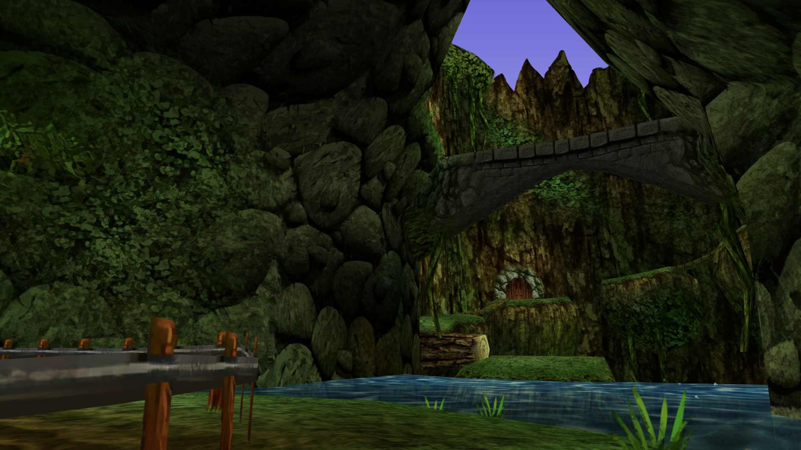
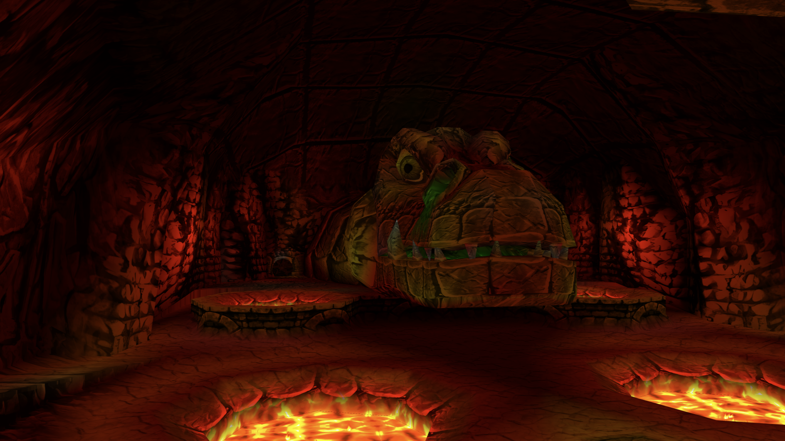
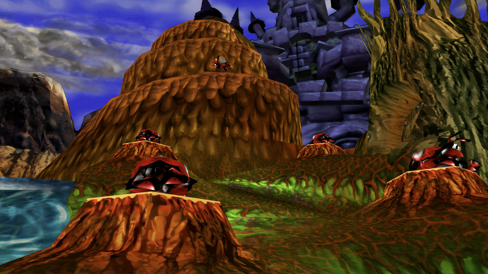
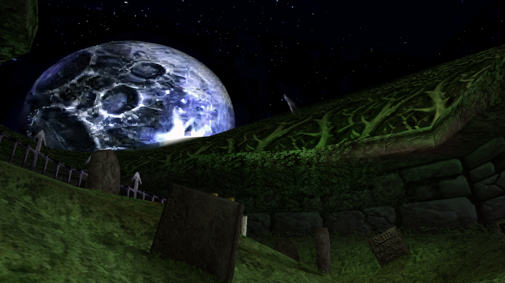

# Conker's Bad Fur Day HD Texture Pack

A high-resolution texture pack for
[Conker's Bad Fur Day Recompiled](https://github.com/DevOldSchool/conkers-bfd-recomp).
It replaces about 10,000 of the game's textures (the levels, skies, signs,
menus, chapter titles and more) with versions four times the original
resolution.

## Installing

1. Download `conkers-hd.rtz` from the
   [latest release](../../releases/latest). Don't unzip it: the game reads the
   file as it is.
2. Put it in the `texture_packs` folder inside the game's data folder,
   creating the folder if it isn't there:
   * macOS: `~/Library/Application Support/ConkersBadFurDayRecompiled/conker-recomp-data/texture_packs`
   * Windows: `%LOCALAPPDATA%\ConkersBadFurDayRecompiled\conker-recomp-data\texture_packs`
   * Linux: `~/.local/share/ConkersBadFurDayRecompiled/conker-recomp-data/texture_packs`

   If you run the game from a folder that has its own `conker-recomp-data`,
   use the `texture_packs` folder in there instead.
3. Start the game. The pack loads on its own.

To compare with the original textures while playing, go to OPTIONS >
GRAPHICS and switch TEXTURE PACKS to N64 TEXTURES. Each switch loads the pack
again, so give it a moment.

## Good to know

* The Xbox, PlayStation and keyboard button pictures still show on top of the
  pack, so prompts always match your controller.
* Online matches work with or without the pack, and players don't all need
  it: it only changes how the game looks on your screen.
* The pack is about 530 MB. A few textures that the game builds while it runs
  (screen effects, some cutscene frames) can't be replaced and stay as they
  were.

## How it was made

Every texture was looked over and given the method that suited it best:

* **4x-GameAI 1.0:** most of the pack, over 9,000 textures, was upscaled with
  the [4x-GameAI 1.0](https://openmodeldb.info/models/4x-GameAI-1-0) model,
  which keeps the game's painted look while adding detail.
* **4x-HDCube3:** about 175 textures where GameAI came out speckled or too
  busy use the [4x-HDCube3](https://openmodeldb.info/models/4x-HDCube3) model.
  It also draws the clean outlines of cut-out textures such as leaves, grass
  and fences.
* **Super-xBR:** about 180 textures with flat colours and hard edges, such as
  text, icons and some signs, use Super-xBR, which keeps lines crisp without
  inventing detail.
* **Hand-painted:** around 90 textures that no upscaler got right were
  painted by hand.

After upscaling, each texture's colours were matched back to the original so
nothing shifts in tone. Textures that tile together (floors, walls, skies,
signs) were joined before upscaling, so the seams between them still line up.

Found a texture that looks wrong? Open an issue with a screenshot and where
in the game it is.

## Legal

This is an unofficial fan project, not affiliated with or endorsed by Rare or
Microsoft. It contains no game code or ROM. You need your own copy of the game to use
it.
